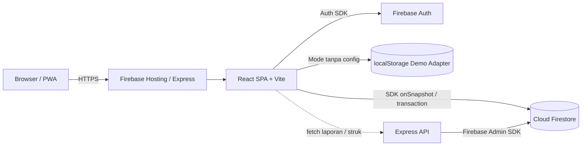

# PRD — E-Cash

**Sistem Manajemen Kasir, Stok & Laporan Keuangan Real-time**

| Field | Keterangan |
| --- | --- |
| Nama Produk | **E-Cash** |
| Versi Dokumen | 1.0 |
| Tanggal | 25 November 2026 |
| Status | Approved — MVP Development |
| Pemilik Produk | Owner E-Cash |
| Platform | Web Application (Responsive: mobile, tablet, desktop) |

---

## 1. Ringkasan Eksekutif

E-Cash adalah aplikasi web manajemen kasir (Point of Sale) untuk usaha ritel, kafe, dan food & beverage yang menggabungkan **transaksi penjualan**, **pengelolaan stok real-time**, **laporan keuangan otomatis**, dan **struk digital** dalam satu dashboard yang informatif.

Aplikasi dibangun sebagai SPA React + Vite dengan Tailwind CSS, Firebase Authentication untuk identitas pengguna, dan Cloud Firestore sebagai basis data real-time. Sebuah layanan Node.js/Express disediakan untuk kebutuhan integrasi lanjutan (laporan agregat server-side, API struk, dan hosting produksi). Seluruh antarmuka dirancang mobile-first sehingga dapat digunakan pada ponsel kasir, tablet di meja kasir, maupun desktop back-office.

### Masalah yang Diselesaikan

1. Pencatatan penjualan masih manual (buku/Excel) sehingga rawan selisih dan lambat direkap.
2. Stok tidak diketahui secara akurat karena mutasi keluar-masuk tidak tercatat per transaksi.
3. Pemilik usaha tidak punya visibilitas omzet, laba, dan produk terlaris secara near real-time.
4. Struk kertas mahal dan mudah hilang; pelanggan membutuhkan bukti transaksi digital.
5. Laporan keuangan bulanan memakan waktu karena harus merekap ulang transaksi.

### Tujuan Produk

| Tujuan | Metrik Keberhasilan |
| --- | --- |
| Mempercepat proses checkout | Rata-rata transaksi selesai < 30 detik |
| Akurasi stok | Selisih stok fisik vs sistem < 1% per bulan |
| Visibilitas bisnis | Dashboard dapat dibuka < 2 detik, data ter-update < 1 detik |
| Efisiensi pelaporan | Laporan periode apa pun tersedia < 5 detik, bisa diekspor |
| Adopsi struk digital | ≥ 40% transaksi dibagikan melalui WhatsApp |

---

## 2. Persona & Peran Pengguna

| Persona | Peran | Kebutuhan Utama |
| --- | --- | --- |
| **Rina — Pemilik usaha** | Owner/Admin | Melihat omzet, laba, produk terlaris, stok menipis; mengatur harga & pajak; mengekspor laporan. |
| **Budi — Kasir** | Cashier | Checkout cepat, cari produk, hitung kembalian, cetak/kirim struk, cek stok tersedia. |
| **Sari — Supervisor** | Supervisor | Melihat transaksi harian, membatalkan (void) transaksi, memantau performa kasir. |

**Hak akses MVP**

- Semua pengguna terautentikasi dapat melakukan transaksi, melihat produk, transaksi, dan laporan.
- Void transaksi dan perubahan pengaturan tersedia untuk pengguna terautentikasi (pembatasan role granular menjadi roadmap Fase 2).
- Manajemen pengguna/staf melalui Firebase Console pada MVP.

---

## 3. Ruang Lingkup

### 3.1 In Scope (MVP)

1. **Autentikasi** — login, registrasi, logout, sesi persisten, proteksi rute.
2. **Dashboard** — KPI omzet/laba/transaksi, grafik tren penjualan, komposisi metode bayar, produk terlaris, peringatan stok rendah, transaksi terakhir.
3. **Kasir (POS)** — pencarian & filter produk, keranjang, diskon, pajak, 4 metode bayar, kalkulasi kembalian, pembuatan transaksi atomik + pengurangan stok.
4. **Produk & Stok** — CRUD produk, kategori, harga jual/modal, stok minimum, restock, riwayat mutasi stok, indikator stok rendah, mode nonaktif.
5. **Transaksi** — daftar & filter transaksi, detail, cetak ulang struk, kirim struk digital, void + pengembalian stok.
6. **Laporan** — rentang tanggal & preset, omzet, laba kotor, jumlah transaksi, rata-rata keranjang, item terjual, breakdown kategori/metode bayar, ekspor CSV.
7. **Struk Digital** — tampilan struk thermal 80 mm, halaman struk publik via tautan, bagikan WhatsApp, cetak browser.
8. **Pengaturan** — identitas toko, pajak, footer struk, data contoh, status koneksi Firebase, reset data demo.
9. **Responsive** — optimal dari 360 px hingga 1920 px (mobile bottom-nav, tablet grid, desktop sidebar).
10. **Mode Demo** — aplikasi tetap dapat dijalankan tanpa konfigurasi Firebase menggunakan penyimpanan lokal, sehingga demo & QA tidak terblokir.

### 3.2 Out of Scope (MVP)

- Multi-outlet / multi-cabang dan sinkronisasi antar cabang.
- Manajemen supplier, purchase order, dan hutang-piutang.
- Integrasi payment gateway (QRIS dinamis, EDC) — MVP mencatat metode bayar secara manual.
- Manajemen shift kasir dan laporan tutup kasir (cash drawer).
- Program loyalitas, member, dan voucher.
- Aplikasi native Android/iOS dan mode offline penuh (PWA offline-first).
- Role-based access control granular (owner vs cashier dibatasi pada UI).

---

## 4. Alur Pengguna Utama

### 4.1 Checkout (Kasir)

```
Login → Kasir → Cari/pilih produk → Keranjang (atur qty)
   → (Opsional) diskon, nama pelanggan, catatan
   → Bayar → Pilih metode → Input nominal (tunai) → Selesaikan
   → Transaksi tersimpan + stok berkurang real-time
   → Struk sukses → Cetak / WhatsApp / Transaksi baru
```

**Aturan bisnis**

- Stok tidak boleh minus. Jika stok berubah saat checkout (race condition), transaksi ditolak dengan pesan jelas.
- Subtotal = Σ(harga jual × qty). Pajak dihitung dari (subtotal − diskon) × tarif pajak, dibulatkan ke rupiah terdekat.
- Total = subtotal − diskon + pajak. Untuk tunai, kembalian = dibayar − total (tidak boleh negatif).
- Diskon tidak boleh melebihi subtotal.
- Nomor invoice unik berformat `INV-YYYYMMDD-####` dari counter atomik.
- Penjualan dan pengurangan stok ditulis dalam satu Firestore transaction (all-or-nothing).

### 4.2 Void Transaksi

```
Transaksi → Pilih transaksi → Detail → Void → Konfirmasi
   → status = void, stok tiap item dikembalikan, tercatat di stockMoves
```

Transaksi void tidak dihitung dalam omzet/laba, tetap tampil di riwayat dengan status Void.

### 4.3 Restock

```
Produk → Restock → Input qty tambahan + catatan → Simpan
   → stok bertambah, mutasi stok tercatat
```

---

## 5. Kebutuhan Fungsional

### FR-01 Autentikasi

| ID | Kebutuhan | Prioritas |
| --- | --- | --- |
| FR-01.1 | Login email + password; validasi format & panjang minimal 6 karakter. | P0 |
| FR-01.2 | Registrasi akun baru; profil awal disimpan di `users/{uid}`. | P0 |
| FR-01.3 | Logout & pembersihan sesi. | P0 |
| FR-01.4 | Sesi persisten (refresh tidak logout). | P0 |
| FR-01.5 | Redirect otomatis ke halaman tujuan setelah login; rute privat terlindungi. | P0 |
| FR-01.6 | Mode demo: login tanpa backend, kredensial contoh ditampilkan. | P1 |

### FR-02 Dashboard

| ID | Kebutuhan | Prioritas |
| --- | --- | --- |
| FR-02.1 | KPI hari ini: omzet, laba kotor, jumlah transaksi, item terjual; dengan perbandingan hari sebelumnya. | P0 |
| FR-02.2 | Grafik area tren omzet 7/30 hari. | P0 |
| FR-02.3 | Donut komposisi metode pembayaran (30 hari). | P1 |
| FR-02.4 | Top 5 produk terlaris berdasarkan qty. | P1 |
| FR-02.5 | Daftar stok menipis (stok ≤ stok minimum) dengan aksi cepat restock. | P0 |
| FR-02.6 | Tabel 6 transaksi terakhir + tautan ke detail. | P1 |
| FR-02.7 | Empty state ramah untuk akun baru dengan CTA menambah produk. | P1 |

### FR-03 Kasir (POS)

| ID | Kebutuhan | Prioritas |
| --- | --- | --- |
| FR-03.1 | Grid produk dengan pencarian nama/SKU dan filter kategori. | P0 |
| FR-03.2 | Tambah ke keranjang; qty bertambah jika produk sama. Produk stok 0 tidak bisa dipilih. | P0 |
| FR-03.3 | Ubah qty (+/−), hapus item, kosongkan keranjang. Qty dibatasi stok. | P0 |
| FR-03.4 | Diskon nominal, nama pelanggan, catatan transaksi. | P1 |
| FR-03.5 | Ringkasan subtotal, pajak, total real-time. | P0 |
| FR-03.6 | Modal pembayaran: Tunai, QRIS, Transfer, Kartu; nominal cepat untuk tunai; validasi kurang bayar. | P0 |
| FR-03.7 | Simpan transaksi atomik + kurangi stok; nomor invoice otomatis. | P0 |
| FR-03.8 | Layar sukses: kembalian, cetak struk, bagikan WhatsApp, mulai transaksi baru. | P0 |
| FR-03.9 | Keranjang responsif (panel kanan di desktop, bottom-sheet di mobile). | P0 |
| FR-03.10 | Indikator stok pada kartu produk dan peringatan saat stok hampir habis. | P1 |

### FR-04 Produk & Stok

| ID | Kebutuhan | Prioritas |
| --- | --- | --- |
| FR-04.1 | Daftar produk (tabel desktop, kartu mobile) dengan pencarian & filter kategori/status. | P0 |
| FR-04.2 | Tambah/edit produk: nama, SKU, kategori, harga jual, harga modal, stok, stok minimum, satuan, emoji, status aktif. | P0 |
| FR-04.3 | SKU otomatis dari nama, dapat diubah; validasi harga/stok non-negatif, nama wajib. | P1 |
| FR-04.4 | Restock dengan qty & catatan; stok bertambah; mutasi tercatat. | P0 |
| FR-04.5 | Hapus produk dengan konfirmasi; riwayat transaksi lama tetap utuh (snapshot item). | P1 |
| FR-04.6 | Badge stok rendah/habis dan ringkasan jumlah produk bermasalah. | P0 |
| FR-04.7 | Data contoh sekali klik untuk akun baru. | P1 |

### FR-05 Transaksi

| ID | Kebutuhan | Prioritas |
| --- | --- | --- |
| FR-05.1 | Daftar transaksi real-time, urut terbaru, maksimum 1.000 transaksi terakhir di klien. | P0 |
| FR-05.2 | Filter: pencarian invoice/pelanggan, rentang tanggal, metode bayar, status. | P0 |
| FR-05.3 | Ringkasan hasil filter (jumlah transaksi & omzet). | P1 |
| FR-05.4 | Detail transaksi: item, kasir, waktu, pembayaran, struk. | P0 |
| FR-05.5 | Void transaksi + pengembalian stok + alasan opsional. | P0 |
| FR-05.6 | Cetak ulang & bagikan struk. | P0 |

### FR-06 Laporan

| ID | Kebutuhan | Prioritas |
| --- | --- | --- |
| FR-06.1 | Preset rentang: hari ini, 7 hari, 30 hari, bulan ini, serta tanggal kustom. | P0 |
| FR-06.2 | KPI: omzet, laba kotor, transaksi, rata-rata/transaksi, item terjual. | P0 |
| FR-06.3 | Grafik omzet & laba harian. | P0 |
| FR-06.4 | Breakdown omzet per kategori dan per metode bayar. | P1 |
| FR-06.5 | Top produk: qty, omzet, laba. | P1 |
| FR-06.6 | Ekspor CSV transaksi pada rentang terpilih. | P0 |
| FR-06.7 | Transaksi void dikecualikan dari seluruh perhitungan. | P0 |

### FR-07 Struk Digital

| ID | Kebutuhan | Prioritas |
| --- | --- | --- |
| FR-07.1 | Struk format thermal 80 mm, tipografi monospace, identitas toko, pajak, pembayaran, kembalian. | P0 |
| FR-07.2 | Halaman publik `/r/:saleId` dapat dibuka tanpa login (tautan struk). | P1 |
| FR-07.3 | Bagikan teks struk ke WhatsApp (opsional nomor pelanggan). | P0 |
| FR-07.4 | Cetak via browser dengan `@page 80mm` dan hanya mencetak area struk. | P0 |

### FR-08 Pengaturan

| ID | Kebutuhan | Prioritas |
| --- | --- | --- |
| FR-08.1 | Identitas toko: nama, tagline, alamat, telepon, footer struk, emoji logo. | P0 |
| FR-08.2 | Pajak: aktif/nonaktif + tarif persen. | P0 |
| FR-08.3 | Ambang stok rendah default untuk produk baru. | P1 |
| FR-08.4 | Info akun & status mode (Demo/Firebase), logout. | P1 |
| FR-08.5 | Muat data contoh & reset data (khusus mode demo). | P1 |

---

## 6. Arsitektur Teknis

### 6.1 Tech Stack

| Layer | Teknologi | Alasan |
| --- | --- | --- |
| UI | React 19 | Komponen deklaratif, ekosistem luas, hooks untuk real-time. |
| Build | Vite 6 | Dev server cepat, build modern, konfigurasi ringkas. |
| Styling | Tailwind CSS 4 | Utility-first, konsisten, mudah responsif, tanpa CSS manual berlebihan. |
| Routing | React Router 7 | Rute SPA, protected route, layout route. |
| Auth | Firebase Authentication | Email/password aman, sesi persisten, siap multi-provider. |
| Database | Cloud Firestore | Real-time listener, transaksi atomik, skala serverless. |
| Chart | Recharts | Grafik deklaratif berbasis SVG, responsif. |
| Ikon | Lucide React | Ikon konsisten dan ringan. |
| Notifikasi | Sonner | Toast aksesibel, ringan. |
| Backend opsional | Node.js 22 + Express | API laporan agregat, API struk, hosting produksi. |
| Admin SDK | Firebase Admin | Akses server-side aman untuk laporan & verifikasi. |

### 6.2 Diagram Arsitektur



### 6.3 Lapisan Data (Data Adapter)

Aplikasi memakai satu antarmuka data (`src/lib/api.js`) dengan dua implementasi:

1. **firebaseApi** — Firestore listener, transaction, counter invoice (produksi).
2. **demoApi** — localStorage + event emitter (demo/QA tanpa Firebase).

Keduanya mengekspos kontrak yang sama: `subscribeProducts`, `subscribeSales`, `subscribeSettings`, `createProduct`, `updateProduct`, `deleteProduct`, `adjustStock`, `createSale`, `voidSale`, `getSale`, `saveSettings`, `seedProducts`, `resetDemoData`.

Pemilihan mode otomatis: jika `VITE_FIREBASE_API_KEY`, `VITE_FIREBASE_PROJECT_ID`, dan `VITE_FIREBASE_APP_ID` tersedia → Firebase; jika tidak → Demo.

### 6.4 Model Data Firestore

```
users/{uid}
  name, email, role, createdAt

settings/store
  storeName, tagline, address, phone, logo, receiptFooter,
  taxEnabled, taxRate, lowStockDefault, updatedAt

products/{productId}
  name, sku, category, price, cost, stock, minStock,
  unit, emoji, active, createdAt, updatedAt

sales/{saleId}
  invoiceNo, items:[{ productId, name, sku, emoji, price, cost, qty, subtotal }],
  subtotal, discount, taxRate, tax, total, paid, change,
  paymentMethod, customerName, note, cashierId, cashierName,
  status: 'paid' | 'void', createdAt, dateKey, voidedAt, voidReason

stockMoves/{moveId}
  productId, productName, type: 'sale'|'restock'|'adjust'|'void',
  qty, before, after, ref, note, userId, createdAt

counters/sales
  seq
```

### 6.5 Aturan Keamanan Firestore (MVP)

- Pengguna terautentikasi: baca/tulis produk, penjualan, pengaturan, counter, mutasi stok.
- Dokumen `users` hanya dapat dibaca/ditulis oleh pemiliknya.
- Penjualan tidak dapat dihapus permanen; pembatalan dilakukan via status `void` (audit trail).
- Dokumen `settings`, `products`, `sales` dapat dibaca publik terbatas untuk halaman struk; produksi multi-tenant akan menambahkan `storeId` dan pembatasan per toko (Fase 2).
- Validasi tipe & rentang nilai di security rules untuk mencegah manipulasi harga dari klien (roadmap: Cloud Functions untuk otorisasi harga).

### 6.6 Struktur Proyek

```
e-cash/
├─ docs/PRD.md
├─ firestore.rules
├─ firestore.indexes.json
├─ firebase.json
├─ .env.example
├─ index.html
├─ src/
│  ├─ components/        # Layout, UI kit, chart, struk, modal
│  ├─ context/           # AuthContext, StoreContext
│  ├─ lib/               # firebase, api, firebaseApi, demoApi, format, receipt, csv
│  ├─ pages/             # Login, Dashboard, POS, Products, Transactions, Reports, Settings, Receipt
│  ├─ App.jsx
│  └─ main.jsx
└─ server/index.js       # Express API opsional + static hosting
```

---

## 7. Kebutuhan Non-Fungsional

| Aspek | Target |
| --- | --- |
| Performa | First contentful paint < 1,5 s pada 4G; interaksi < 100 ms; data real-time < 1 s. |
| Responsif | 360–639 px (mobile), 640–1023 px (tablet), ≥1024 px (desktop). Tidak ada horizontal scroll. |
| Aksesibilitas | Kontras WCAG AA, navigasi keyboard, label form, focus ring, aria pada tombol ikon. |
| Keamanan | Auth wajib untuk rute privat; validasi input client + rules; tidak ada secret di bundle; env terpisah. |
| Reliabilitas | Transaksi stok atomik; retry/error message jelas; listener auto-reconnect. |
| Skalabilitas | Firestore serverless; query dibatasi (1.000 transaksi terakhir) dan laporan berat dilayani API. |
| Maintainability | Pemisahan lapisan data/UI, komponen reusable, helper terpusat, tanpa `any` type longgar. |
| Kompatibilitas | Chrome/Edge/Safari/Firefox versi terkini; iOS Safari 16+; Android Chrome 110+. |
| Lokalisasi | Bahasa Indonesia, format Rupiah (`Rp 12.500`), tanggal `dd MMM yyyy`, zona waktu lokal. |
| Observability | Error ditampilkan via toast; mode & status koneksi tampil di Pengaturan. |

---

## 8. Desain & UX

### 8.1 Prinsip

1. **Checkout tanpa hambatan** — maksimal 3 klik dari produk ke pembayaran.
2. **Informasi penting di atas** — KPI, stok kritis, dan status transaksi selalu terlihat.
3. **Konsisten & tenang** — palet emerald + slate, kartu lembut, hierarki tipografi jelas.
4. **Mobile-first** — target sentuh ≥ 44 px, bottom navigation, panel keranjang slide-up.
5. **Umpan balik instan** — skeleton, optimistic UI, toast, animasi halus.

### 8.2 Design Token

| Token | Nilai |
| --- | --- |
| Primary | Emerald `#10B981` (hover `#059669`) |
| Sidebar | Ink `#0B1220` |
| Latar | Slate 50 `#F8FAFC` |
| Teks utama | Slate 900 `#0F172A` |
| Sukses / Warning / Danger | Emerald / Amber / Rose |
| Radius | 12–20 px (kartu 16 px, tombol 12 px) |
| Font | Plus Jakarta Sans (fallback system UI) |
| Breakpoint | `sm 640`, `md 768`, `lg 1024`, `xl 1280` |

---

## 9. Rencana Rilis

| Fase | Cakupan | Estimasi |
| --- | --- | --- |
| **Fase 0 — Setup** | Scaffold, Firebase, Tailwind, auth, layout, data adapter | 2 hari |
| **Fase 1 — MVP Core** | Produk, kasir, transaksi, struk, dashboard | 6 hari |
| **Fase 2 — Insight** | Laporan, ekspor, pengaturan, responsive polish | 3 hari |
| **Fase 3 — Hardening** | Security rules, uji perangkat, seed data, dokumentasi | 2 hari |
| **Fase 4 — Growth** | Multi-outlet, role granular, shift kasir, payment gateway, PWA offline | Kuartal berikutnya |

---

## 10. Kriteria Penerimaan (Acceptance Criteria)

1. Pengguna dapat mendaftar, login, logout, dan sesi bertahan setelah refresh.
2. Rute privat tidak dapat diakses tanpa autentikasi.
3. Menambah produk langsung muncul di POS dan dashboard tanpa refresh.
4. Checkout berhasil membuat 1 dokumen `sales`, mengurangi stok sesuai qty, dan menambah counter invoice.
5. Checkout dengan stok tidak cukup ditolak tanpa mengubah data apa pun.
6. Total, pajak, dan kembalian sesuai rumus dan tampil benar dalam format Rupiah.
7. Void mengembalikan stok dan mengeluarkan transaksi dari omzet/laba.
8. Struk dapat dicetak (layout 80 mm), dibagikan via WhatsApp, dan dibuka via tautan publik.
9. Laporan untuk rentang tanggal menampilkan omzet, laba, transaksi, produk terlaris, dan ekspor CSV yang nilainya konsisten dengan daftar transaksi.
10. Seluruh halaman dapat digunakan pada lebar 360 px, 768 px, dan 1440 px tanpa overflow.
11. Aplikasi berjalan tanpa konfigurasi Firebase (mode demo) dan sepenuhnya via Firebase setelah `.env` diisi.
12. Build produksi (`npm run build`) sukses tanpa error.

---

## 11. Risiko & Mitigasi

| Risiko | Dampak | Mitigasi |
| --- | --- | --- |
| Race condition stok saat 2 kasir checkout bersamaan | Oversell | Firestore transaction + validasi stok di dalam transaksi. |
| Firebase belum dikonfigurasi saat demo | Aplikasi tidak bisa dicoba | Mode demo localStorage otomatis. |
| Data transaksi menumpuk | Query lambat | Limit 1.000 di klien, laporan berat via API Admin SDK, arsip berkala. |
| Koneksi internet putus | Transaksi gagal | Pesan error jelas, listener auto-reconnect; offline queue di roadmap. |
| Kebocoran data antar toko | Privasi | `storeId` + rules per tenant di Fase 2. |
| Manipulasi harga dari klien | Kerugian | Harga diambil ulang dari dokumen produk di dalam transaction; validasi server di roadmap. |

---

## 12. Glosarium

- **POS** — Point of Sale, antarmuka kasir.
- **Void** — pembatalan transaksi dengan pengembalian stok.
- **Restock** — penambahan stok produk.
- **COGS** — harga pokok penjualan (harga modal).
- **Laba kotor** — omzet − COGS.
- **Struk digital** — bukti transaksi elektronik yang dapat dicetak/dibagikan.
